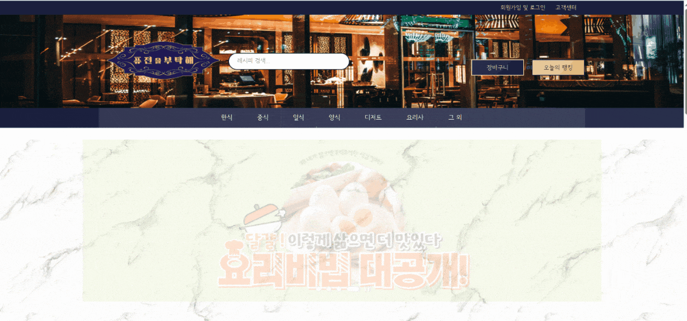

# 레시피를 부탁해 (Recipe Please)

<div align="center">
  
</div>

## 📋 프로젝트 소개

**레시피를 부탁해**는 다양한 요리 레시피를 제공하고 음식점 정보를 검색할 수 있는 웹사이트입니다. 사용자는 한식, 중식, 일식, 양식, 디저트 등 다양한 카테고리의 요리법을 찾아보고, 실제 요리를 만들어보거나 해당 음식을 제공하는 주변 맛집을 찾을 수 있습니다.

> 📹 **위 시연 영상**: 웹사이트의 주요 기능들을 보여주는 실제 동작 화면입니다.

## 🎯 주요 기능

### 🍽️ 음식 카테고리별 검색

- **한식**: 김치찌개, 떡볶이, 불고기 등
- **중식**: 짜장면, 탕수육, 마파두부 등
- **일식**: 초밥, 라면, 카레 등
- **양식**: 파스타, 스테이크, 샐러드 등
- **디저트**: 케이크, 마카롱, 아이스크림 등

### 🔍 레시피 검색 및 상세보기

- 인기 레시피 랭킹 제공
- 상세한 요리 과정 안내
- 유튜브 동영상 연동
- 별점 및 댓글 시스템

### 🗺️ 맛집 검색 기능

- Google Maps API 연동
- 주변 음식점 검색
- 위치 기반 맛집 추천

### 👤 회원 시스템

- 회원가입 및 로그인
- 마이페이지
- 찜하기 기능
- 개인 맞춤 추천

## 🛠️ 기술 스택

### Frontend

- **HTML5**: 웹 페이지 구조
- **CSS3**: 반응형 디자인 및 스타일링
- **JavaScript**: 동적 기능 및 사용자 인터랙션
- **Google Maps API**: 지도 및 위치 서비스

### 디자인

- **반응형 웹 디자인**: 모바일, 태블릿, 데스크톱 지원
- **사용자 친화적 UI/UX**: 직관적인 네비게이션
- **시각적 효과**: 호버 효과, 슬라이드 이미지

## 📁 프로젝트 구조

```
TeamProjectA/
├── public/
│   ├── html&Js/              # HTML 및 JavaScript 파일
│   │   ├── main.html         # 메인 페이지
│   │   ├── login_signup.html # 로그인/회원가입 페이지
│   │   ├── recipeinfo1.html  # 레시피 상세 페이지 1
│   │   ├── recipeinfo2.html  # 레시피 상세 페이지 2
│   │   ├── recipeinfo3.html  # 레시피 상세 페이지 3
│   │   ├── mypage.html       # 마이페이지
│   │   ├── wishlist.html     # 찜 목록
│   │   └── signupSuccess.html # 회원가입 성공 페이지
│   ├── css/                  # 스타일시트 파일
│   │   ├── main.css          # 메인 스타일
│   │   ├── login_signup.css  # 로그인/회원가입 스타일
│   │   ├── recipeinfo.css    # 레시피 상세 스타일
│   │   ├── mypage.css        # 마이페이지 스타일
│   │   ├── wishlist.css      # 찜 목록 스타일
│   │   └── style.css         # 공통 스타일
│   ├── img/                  # 이미지 파일
│   │   ├── headerlogo.png    # 헤더 로고
│   │   ├── slide1.png        # 슬라이드 이미지 1
│   │   ├── slide2.jpg        # 슬라이드 이미지 2
│   │   ├── slide3.jpg        # 슬라이드 이미지 3
│   │   ├── slide4.png        # 슬라이드 이미지 4
│   │   ├── Donkatsu.jpg      # 돈가스 이미지
│   │   ├── fishdump.jpg      # 피시 앤 만두 이미지
│   │   ├── pigstew.jpg       # 돼지 스튜 이미지
│   │   ├── movingimg1.gif    # 움직이는 이미지 1
│   │   ├── movingimg2.gif    # 움직이는 이미지 2
│   │   ├── movingimg3.gif    # 움직이는 이미지 3
│   │   └── ...               # 기타 이미지들
│   ├── fonts/                # 폰트 파일
│   │   └── SeoulNamsanL.ttf  # 서울남산체
│   └── yeon/                 # 카테고리별 페이지
│       ├── firstinterface.html # 첫 화면 인터페이스
│       ├── koreanfood.html    # 한식 페이지
│       ├── chinesefood.html   # 중식 페이지
│       ├── japanesefood.html  # 일식 페이지
│       ├── westernfood.html   # 양식 페이지
│       ├── desert.html        # 디저트 페이지
│       ├── goeat.html         # 맛집 찾기 페이지
│       └── makeat.html        # 요리 만들기 페이지
├── source/
│   └── recipe1.gif           # 레시피 시연 영상 (README.md 상단에 표시)
└── README.md                 # 프로젝트 설명서
```

## 🚀 시작하기

### 0. 시연 영상 (GIF)

README.md 파일 상단에 표시되는 시연 영상은 `source/recipe1.gif` 파일을 사용합니다.
이 GIF 파일은 웹사이트의 주요 기능들을 보여주는 시연 영상입니다.

### 1. 프로젝트 클론

```bash
git clone https://github.com/username/recipe-please.git
cd recipe-please
```

### 2. 웹 서버 실행

프로젝트는 정적 HTML 파일로 구성되어 있으므로, 간단한 HTTP 서버를 통해 실행할 수 있습니다.

**방법 1: Python 서버 사용**

```bash
# Python 3.x
python -m http.server 8000

# Python 2.x
python -m SimpleHTTPServer 8000
```

**방법 2: Node.js 서버 사용**

```bash
npx http-server
```

**방법 3: Live Server (VS Code 확장)**
VS Code에서 Live Server 확장을 설치하고 `public/html&Js/main.html` 파일을 열어 실행

### 3. 브라우저에서 접속

```
http://localhost:8000/public/html&Js/main.html
```

## 🔧 Google Maps API 설정

지도 기능을 사용하려면 Google Maps API 키가 필요합니다.

1. [Google Cloud Console](https://console.cloud.google.com/)에서 프로젝트 생성
2. Maps JavaScript API 활성화
3. API 키 생성
4. `public/html&Js/main.html` 파일에서 API 키 교체:
   ```html
   <script src="https://maps.googleapis.com/maps/api/js?key=YOUR_API_KEY&callback=initMap"></script>
   ```

## 📱 주요 페이지

### 🏠 메인 페이지 (`main.html`)

- 헤더 네비게이션 (로그인/회원가입, 고객센터 링크)
- 로고 및 검색바
- 카테고리 메뉴 (한식, 중식, 일식, 양식, 분식, 요리사, 그 외)
- 광고 슬라이드 (3개 이미지 순환)
- "가장 많이 찾아 본 레시피" 섹션
- "제철 추천메뉴" 섹션
- 각 요리 카드별 찜하기 기능
- 구글 맵 연동 "주변 맛집 찾기" 기능
- 푸터 (고객센터 정보, 소셜 미디어 링크)

### 🔐 로그인/회원가입 (`login_signup.html`)

- 통합 로그인/회원가입 폼
- 애니메이션 효과가 있는 패널 전환
- 반응형 디자인
- 폼 validation

### 📖 레시피 상세 페이지 (`recipeinfo1.html`, `recipeinfo2.html`, `recipeinfo3.html`)

- **recipeinfo1.html**: 피시 앤 만두 (오세득 셰프)
- **recipeinfo2.html**: 돼지가 스튜에 빠진 날 (샘킴 셰프)
- **recipeinfo3.html**: 이연복Go 연복Go♬ (이연복 셰프)
- 요리 과정 상세 안내 (18단계 이상)
- 유튜브 동영상 임베드
- 별점 및 댓글 시스템
- 조회수 추적 (로컬 스토리지 활용)
- 로그인 체크 기능

### 👤 마이페이지 (`mypage.html`)

- 사용자 정보 관리
- 찜한 레시피 목록
- 개인 설정

### 🍜 카테고리별 페이지 (`yeon/` 폴더)

- **firstinterface.html**: 첫 화면 인터페이스 (로고, 메뉴, 인기 레시피 랭킹)
- **koreanfood.html**: 한식 카테고리 (6개 메뉴)
- **chinesefood.html**: 중식 카테고리 (6개 메뉴)
- **japanesefood.html**: 일식 카테고리 (6개 메뉴)
- **westernfood.html**: 양식 카테고리 (6개 메뉴)
- **desert.html**: 디저트 카테고리 (6개 메뉴)
- **goeat.html**: 먹으러 가기 (맛집 찾기)
- **makeat.html**: 만들어 먹기 (레시피 만들기)

## 🎨 디자인 특징

### 색상 팔레트

- 메인 컬러: `#c2b228` (황금색)
- 서브 컬러: `#4CAF50` (초록색)
- 배경색: `#f5f5f5` (연한 회색)

### 반응형 디자인

- 모바일 우선 설계
- 태블릿 및 데스크톱 지원
- 유연한 그리드 시스템

### 사용자 경험

- 직관적인 네비게이션
- 부드러운 호버 효과
- 접근성 고려한 디자인

## 🔄 최근 업데이트 (2024.02.22)

- HTML과 JavaScript 파일 통합 및 구조 개선
- 폴더 구조 정리: `html&js`, `css`, `fonts`, `img`로 분리
- 레시피 상세 페이지 CSS 분리
- 헤더 로고 삽입 및 네비게이션 개선
- 새로운 이미지 파일 추가
- 반응형 디자인 개선

## 📊 기능별 구현 현황

- [x] 메인 페이지 레이아웃
- [x] 로그인/회원가입 시스템
- [x] 레시피 상세 페이지
- [x] 카테고리별 음식 페이지
- [x] Google Maps 연동
- [x] 반응형 디자인
- [x] 이미지 슬라이드
- [x] 찜하기 기능
- [x] 별점 및 댓글 시스템
- [x] 검색 기능

## 🤝 기여하기

1. 이 저장소를 Fork하세요
2. 기능 브랜치를 생성하세요 (`git checkout -b feature/amazing-feature`)
3. 변경사항을 커밋하세요 (`git commit -m 'Add amazing feature'`)
4. 브랜치에 푸시하세요 (`git push origin feature/amazing-feature`)
5. Pull Request를 생성하세요

## 📝 라이선스

이 프로젝트는 MIT 라이선스 하에 배포됩니다. 자세한 내용은 [LICENSE](LICENSE) 파일을 참조하세요.

## 📞 문의

프로젝트에 대한 문의사항이 있으시면 아래 연락처로 문의해주세요:

- 이메일: smanew28@gmail.com
- 전화: 1234-5678
- 주소: 서울특별시 영등포구 테헤란로 123

---

⭐ 이 프로젝트가 도움이 되셨다면 Star를 눌러주세요!
